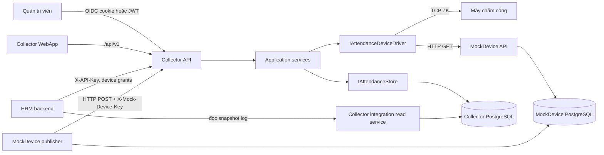

# Mô tả phân hệ máy chấm công trong Collector

Tài liệu mô tả kiến trúc, đường kết nối, hợp đồng dữ liệu và các điểm vận hành của phân hệ máy chấm công. Nội dung phản ánh implementation hiện tại trong `src/`; khi có khác biệt giữa tài liệu cũ và source, source cùng migration đang áp dụng là căn cứ cuối.

## 1. Phạm vi và khái niệm

Collector nhận dữ liệu chấm công từ các nguồn, chuẩn hóa thành attendance log, lưu PostgreSQL và cung cấp hai nhóm API:

1. API quản trị cho dashboard Collector: đăng ký nguồn, bật/tắt, pull thủ công, xem log và lịch sử chạy.
2. API integration cho HRM: liệt kê thiết bị được cấp quyền, kiểm tra kết nối, yêu cầu pull và đọc log theo khoảng thời gian với snapshot/paging.

`AttendanceDevice` được gọi là source trong dashboard/API quản trị. `deviceId` trong API integration là GUID của chính bản ghi Collector; HRM lưu/mapping ID này riêng, không dùng ID nguồn attendance của HRM.

Driver hiện có:

| `driverCode` | Hướng dữ liệu | Ý nghĩa |
| --- | --- | --- |
| `zk-compatible-tcp` | Pull | Đọc máy tương thích giao thức ZK qua TCP; thường dùng cổng 4370. |
| `mock-device-http` | Pull | Collector gọi dịch vụ MockDevice qua HTTP để đọc danh sách sự kiện giả lập. |
| `mock-device-push` | Push | MockDevice gửi batch vào Collector. Đây là source mẫu được tạo khi migration/startup và không được đưa vào danh sách driver pull mới. |

## 2. Kiến trúc và luồng dữ liệu

Trách nhiệm theo lớp:

| Lớp | Vai trò | Điểm vào/ra chính |
| --- | --- | --- |
| `API` | HTTP, authentication/authorization, controller, hosted worker | `AttendanceSourcesController`, `AttendanceController`, `AttendanceIngestionController`, `IntegrationDevicesController`, `HourlyAttendanceCollectionWorker` |
| `Application` | Use case, chuẩn hóa thời gian, fingerprint, điều phối driver và store | `AttendanceSourceService`, `AttendanceCollectionService`, `AttendanceIngestionService`, `IAttendanceDeviceDriver`, `IAttendanceStore` |
| `Domain` | Mô hình và trạng thái nghiệp vụ | `AttendanceDevice`, `AttendanceLog`, `AttendanceCollectionRun`, `AttendanceCollectionStatus` |
| `Infrastructure` | Driver giao thức, EF Core/PostgreSQL và lưu trữ | `Services/Devices/*`, `AttendanceStore`, `AttendanceCollectorDbContext`, `AttendanceConfigurations` |
| `WebApp` | Quản lý nguồn, khởi chạy pull, xem logs/runs | `src/attendanceCollector.WebApp/src/main.ts`, `api-client.ts`, `models.ts` |
| `MockDevice` | Dữ liệu giả lập; có API đọc và publisher push riêng | `MockDeviceService`, `MockDeviceAttendanceBatchV1` |

Driver được đăng ký trong `Infrastructure/DependencyInjection.cs`. Application tra driver theo `DriverCode` không phân biệt hoa thường; thêm driver cần implementation `IAttendanceDeviceDriver`, đăng ký DI, kiểm tra validation/cấu hình, rồi cập nhật giao diện và tài liệu.

## 3. Kết nối và cấu hình mạng

### Collector chạy bằng Docker Compose

| Thành phần | Host/port thường dùng | Ghi chú |
| --- | --- | --- |
| Collector WebApp + API | `localhost:4210` → container `api:8080` | Cổng host cấu hình bằng `LOCAL_APP_PORT`. |
| Collector PostgreSQL | `localhost:5433` → container `postgres:5432` | Có thể đổi qua `LOCAL_DB_PORT`; dùng volume riêng. |
| MockDevice HTTP | Trong Docker network: `mock-device:8080`; từ host: `localhost:4300` | `mock-device-http` gọi `GET /health/live` và `GET /api/v1/device/attendance`. |
| MockDevice PostgreSQL | Compose nội bộ | Database/volume riêng, không phải DB Collector. |
| Keycloak Collector local | `localhost:8081` | Tùy chọn, cấu hình tại `docker-compose.keycloak.local.yml`. |
| Máy ZK | IP private của máy + TCP port, thường `4370` | API container phải route được tới IP này và firewall phải cho phép TCP. |

Collector và MockDevice phải dùng chung Docker network `attendance-collector-network` khi MockDevice gọi `api:8080`. Cấu hình network qua `ATTENDANCE_NETWORK_NAME`. Chạy MockDevice bằng `docker-compose.mock-device.yml`; phần hướng dẫn khởi động đầy đủ có trong [README](../README.md#attendance-sources-and-collection-logs).

Driver `zk-compatible-tcp` hiện chỉ chấp nhận IPv4 private thuộc `10/8`, `172.16/12` hoặc `192.168/16`; hostname, IPv6, public IP và tên `host.docker.internal` sẽ bị từ chối. Đặt IP nội bộ thực tế mà container truy cập được. Cổng mặc định UI là 4370; `CommunicationKey` là mật khẩu/communication key số của thiết bị, mặc định 0.

Các thông số source quản trị gồm `Host`, `Port`, `CommunicationKey`, `TimeoutSeconds`, `TimeZoneId`. Với ZK, timeout kết nối và đọc hiện lấy từ cấu hình chung `AttendanceDevices:Zkteco:TimeoutSeconds` (mặc định 15 giây), không lấy timeout từng source. Số bản ghi tối đa mỗi lần đọc lấy từ `AttendanceDevices:Zkteco:MaximumRecordsPerRead` (mặc định 50.000, implementation chặn trong khoảng 1–200.000). Giá trị timeout theo source vẫn được validate/lưu/đọc lại nhưng driver ZK hiện chưa dùng.

`mock-device-http` dùng `TimeoutSeconds` của source và URL HTTP được ghép từ `Host` + `Port`. Trong Docker, dùng host `mock-device`, port `8080`; thời gian máy giả lập cố định theo `Asia/Bangkok`.

## 4. Đăng ký source và hợp đồng quản trị

`AttendanceSourceRequest` nhận các trường:

| Trường | Quy tắc hiện tại |
| --- | --- |
| `code` | Bắt buộc, 1–32 ký tự; trim và chuẩn hóa chữ hoa; phải duy nhất. |
| `name` | Bắt buộc, 1–120 ký tự. |
| `driverCode` | Bắt buộc, tối đa 64 ký tự; phải là driver đã đăng ký và không phải `mock-device-push`. |
| `host` | Bắt buộc, tối đa 255 ký tự; source service kiểm tra chuỗi host/IP hợp lệ. Driver có thể kiểm tra chặt hơn khi kết nối. |
| `port` | 1–65535; mặc định request là 4370. |
| `communicationKey` | Số nguyên không âm; driver ZK dùng làm communication key. |
| `timeoutSeconds` | 1–120; mặc định 10. Dùng trực tiếp bởi HTTP MockDevice; ZK đang dùng timeout cấu hình chung. |
| `timeZoneId` | Bắt buộc và phải được hệ điều hành của Collector nhận diện; mặc định `Asia/Bangkok`. |

Tạo source mới sẽ bật source (`IsActive=true`). API hỗ trợ cập nhật bằng `PUT`, nhưng UI hiện tại chỉ tạo và bật/tắt; chưa có biểu mẫu sửa source. API quản trị yêu cầu người dùng thuộc policy `BootstrapAdmin`. Các request ghi dữ liệu cần antiforgery token; WebApp lấy token từ `/auth/csrf` và gửi `X-CSRF-TOKEN`.

## 5. API và kết nối giữa các thành phần

### Collector WebApp / quản trị viên

Các route dưới đây bắt đầu bằng `/api/v1` và dùng session cookie OIDC hoặc JWT theo cấu hình API:

| Method + route | Chức năng |
| --- | --- |
| `GET /attendance-sources/drivers` | Liệt kê driver pull được hỗ trợ; không liệt kê `mock-device-push`. |
| `GET /attendance-sources` | Liệt kê source đã đăng ký, gồm cả push source mẫu. |
| `POST /attendance-sources` | Tạo source. |
| `PUT /attendance-sources/{id}` | Cập nhật thông tin source. |
| `PATCH /attendance-sources/{id}/active` | Bật/tắt source. |
| `POST /attendance-sources/{id}/collect` | Pull thủ công; trả collection run kể cả khi driver lỗi (run có trạng thái `Failed`). |
| `GET /attendance/logs` | Xem log có phân trang, lọc theo source, employee code, thời gian UTC. |
| `GET /attendance/collections` | Xem lịch sử run; page size tối đa 100. |

Không có route kiểm tra kết nối riêng cho dashboard hiện tại, dù driver có `CheckConnectionAsync`. Route kiểm tra kết nối hiện được expose qua API integration cho client HRM có quyền collect.

### MockDevice push

MockDevice gửi `POST /api/v1/attendance-ingestion/mock-device` với header `X-Mock-Device-Key`. Body có `sourceCode` và 1–500 records. Collector chỉ chấp nhận `sourceCode = MOCK-DEVICE-001`, source tồn tại, đang active và dùng `mock-device-push`. Key được cấu hình qua `MOCK_DEVICE_INGESTION_API_KEY` cho cả API Collector và publisher. Publisher tạo/lưu event trong DB MockDevice, gửi batch; chỉ đánh dấu event đã gửi sau khi nhận response thành công.

### HRM integration

API integration dùng header `X-API-Key`, device grant và policy collect cho các thao tác thu thập/kết nối. Chi tiết về provisioning key, quyền, snapshot, audit, rate limit và triển khai production nằm trong [runbook integration](collector-integration-runbook.md) và [OpenAPI](collector-api.openapi.yaml).

| Method + route | Chức năng |
| --- | --- |
| `GET /api/v1/devices` | Liệt kê active devices được grant; không trả host/port. |
| `POST /api/v1/devices/{deviceId}/connection` | Gọi `CheckConnectionAsync`; trả `isConnected` và thông báo an toàn. Push source không hỗ trợ kết nối. |
| `POST /api/v1/devices/{deviceId}/collect` | Pull thủ công nếu integration client có `AllowCollection` và grant thiết bị. |
| `GET /api/v1/devices/{deviceId}/attendance-logs` | Đọc log theo khoảng UTC, trả page token opaque trên snapshot cố định. |

`deviceId` integration là GUID của `AttendanceDevice` tại Collector. HRM không được dùng hostname/port để định tuyến và Collector không công khai các trường mạng qua API integration.

## 6. Mapping dữ liệu từ thiết bị vào log

Luồng pull: driver đọc bản ghi thô → `DeviceAttendanceEntry` → `AttendanceCollectionService.ToLog` → `AttendanceLog` → `AttendanceStore`. Luồng push dùng contract `MockDeviceAttendanceRecordV1` và `AttendanceIngestionService.ToLog`; hai luồng cùng dùng bảng `AttendanceLogs` nhưng quy tắc fingerprint khác nhau.

| Dữ liệu nguồn | `DeviceAttendanceEntry` / push contract | Cột `AttendanceLogs` | Ghi chú |
| --- | --- | --- | --- |
| Source identity | `AttendanceDevice.Id` | `DeviceId` | Khóa ngoại tới `AttendanceDevices`. |
| Mã nhân viên / User ID trên máy | `EmployeeCode` / ZK `UserId` | `EmployeeCode` | Hiện được lưu thành `""` cho cả pull và push; migration `20261109000100_PurgePersistedEmployeeCodes` cũng xóa mã đã lưu trước đó. Không dùng field này để suy ra hồ sơ HRM ở trạng thái hiện tại. |
| Tên nhân viên | `EmployeeName` | `EmployeeName` | Trim khoảng trắng; ZK driver hiện không đọc tên nên giá trị là chuỗi rỗng. |
| Thời điểm tại máy | `DeviceLocalTime` | `OccurredAtLocal` | Lưu nguyên local time, `timestamp without time zone`, khi ingest. |
| Timezone cấu hình source | `AttendanceDevice.TimeZoneId` | `TimeZoneIdAtCapture` | Lưu snapshot tên timezone dùng lúc ingest; không dựa vào cấu hình source đổi sau này. |
| Thời điểm UTC đã chuẩn hóa | Chuyển từ `DeviceLocalTime` theo timezone source | `OccurredAtUtc` | `DateTime` đầu vào được coi là `Unspecified`; từ chối giờ DST mơ hồ/không tồn tại, sau đó đổi sang UTC. |
| Độ lệch ở thời điểm capture | Chênh `DeviceLocalTime` so với UTC | `UtcOffsetMinutesAtCapture` | Ghi offset theo phút tại thời điểm đó. |
| Status và punch thô | `Status`, `Punch` | `Status`, `Punch` | Giữ integer do thiết bị gửi, không chuẩn hóa thành loại event HRM trong Collector. |
| UID record của thiết bị | `SourceRecordUid` | `SourceRecordUid` | Tùy driver có thể null; ZK UID chỉ map khi lớn hơn 0. |
| Thời điểm Collector nhận | Đồng hồ UTC của Collector | `ReceivedAtUtc` | Không phải thời điểm sự kiện chấm công. |

API quản trị log trả `EmployeeCode` hiện thường là chuỗi rỗng. API raw export cho HRM tạo read snapshot với các field:

| Field HRM integration | Mapping hiện tại |
| --- | --- |
| `deviceUserId` | `NULLIF(AttendanceLogs.EmployeeCode, '')`; hiện thường `null` do chính sách xóa/không lưu mã nhân viên. |
| `deviceUid` | `SourceRecordUid` ép sang 64-bit. |
| `deviceName` | `NULLIF(EmployeeName, '')`; tên hiển thị nhận từ driver nếu driver cung cấp. |
| `occurredAtLocal` | `OccurredAtLocal`; với log push legacy thiếu local time, chỉ suy ra từ UTC khi driver là `mock-device-push` và source timezone là `Asia/Bangkok`. Log legacy driver khác thiếu metadata sẽ không export được. |
| `rawStatus`, `rawPunch` | `Status`, `Punch` giữ nguyên integer từ nguồn. |

Đây là dữ liệu thô, không có mapping mã nhân viên sang employee ID của HRM và không phân loại `Status`/`Punch` thành in/out. Nếu HRM cần EmployeeCode, cần rà lại yêu cầu bảo vệ dữ liệu và migration trước khi đổi luồng lưu.

## 7. Chuẩn hóa, khử trùng và lịch thu thập

- Manual pull và worker định kỳ cùng đi qua `IAttendanceCollectionService`.
- Worker chạy khi sang mỗi giờ UTC; giữ advisory lock PostgreSQL `7306110602` để chỉ một replica chạy lịch tại cùng thời điểm. Vì giờ Việt Nam là UTC+07, mốc này cũng trùng đầu giờ địa phương.
- Worker thu thập source active, bỏ qua driver `mock-device-push`. Mỗi source lỗi được ghi log và không chặn source kế tiếp.
- `AttendanceCollectionRun` ghi `StartedAtUtc`, `CompletedAtUtc`, `Status`, `RecordsReceived`, `RecordsAdded`, `ErrorMessage`. Status là `Running`, `Succeeded` hoặc `Failed`.
- Trong một process, `AttendanceCollectionService` dùng semaphore theo source để tuần tự hóa pull thủ công/job cùng máy. Advisory lock lịch không khóa thao tác thủ công qua API trên các replica khác.
- `AttendanceStore.AddLogsAsync` chia batch DB tối đa 400 log, loại log trùng fingerprint và kiểm tra thêm tổ hợp device + source UID + UTC time + status + punch.
- Pull fingerprint là SHA-256 của `deviceId`, UID (hoặc literal `uid-unavailable`), UTC occurred time, status, punch. Push fingerprint là SHA-256 của `deviceId`, UID (hoặc `EventId`), UTC occurred time. DB có unique index trên `Fingerprint`.
- `RecordsReceived` đếm số bản ghi driver trả về; `RecordsAdded` đếm số dòng mới được lưu sau khử trùng. Hai con số có thể khác nhau trong các lần đọc lại.
- Lỗi xảy ra sau khi tạo run được ghi thành run `Failed`; với API quản trị, controller vẫn trả DTO kết quả. Lỗi validation/source không tồn tại/inactive trước khi bắt đầu run có thể trả lỗi HTTP.

## 8. Database và vòng đời schema

Các entity attendance chính nằm trong cùng `AttendanceCollectorDbContext` và PostgreSQL Collector:

| Bảng | Nội dung |
| --- | --- |
| `AttendanceDevices` | Source, driver, endpoint, communication key, timeout, timezone, active state. `Code` unique. |
| `AttendanceLogs` | Bản ghi sự kiện đã chuẩn hóa; fingerprint unique, FK tới source với delete restrict. |
| `AttendanceCollectionRuns` | Lịch sử từng lần collect/push batch, có FK tới source. |
| `AttendanceReadSnapshots`, `AttendanceReadSnapshotRows` | Bản chụp dữ liệu dành cho API HRM paging; đây là read model tạm có TTL, không phải bảng log gốc. |

Migration được quản lý trong `src/attendanceCollector.Infrastructure/Persistence/Migrations`. Development mặc định tự migrate; staging/production cần migration riêng trước khi nâng API theo hướng dẫn deployment. Source mẫu `MOCK-DEVICE-001` được tạo nếu chưa tồn tại khi migration/startup attendance áp dụng. Không chỉnh trực tiếp DB đang chạy để thêm cột hoặc xóa log.

## 9. Sự cố thường gặp

| Triệu chứng | Kiểm tra |
| --- | --- |
| ZK timeout / không kết nối | IP là private IPv4; container route/firewall tới TCP port; máy đã bật giao thức tương thích; port/communication key đúng; kiểm tra timeout toàn cục `AttendanceDevices:Zkteco`. |
| ZK host hợp lệ khi lưu nhưng pull bị từ chối | Validation API chỉ xác minh host/IP nói chung; driver ZK chặn DNS/IPv6/public IP. Dùng IPv4 private. |
| MockDevice HTTP không resolve | Collector và MockDevice cùng network; source host `mock-device`, port `8080`; kiểm tra `GET /health/live` từ network. |
| Push trả 401 | Hai bên khớp `MOCK_DEVICE_INGESTION_API_KEY`; header thực là `X-Mock-Device-Key`; tránh nhầm với `X-API-Key` của HRM integration. |
| Push trả lỗi source | Source `MOCK-DEVICE-001` phải tồn tại, active và có `DriverCode=mock-device-push`; bật lại source nếu đã deactivate. |
| `RecordsReceived` lớn hơn `RecordsAdded` | Thường là sự kiện đã thu nhận từ lần trước; xem thêm fingerprint, UID, giờ máy/timezone nếu có record thật sự bị hợp nhất sai. |
| Giờ log lệch | Đồng hồ/timezone trên máy và `TimeZoneId` source; API lấy giờ local do máy gửi và đổi theo timezone source. Không nhập UTC vào field giờ local. |
| Giờ bị từ chối quanh chuyển DST | Thời gian local rơi vào giờ không tồn tại hoặc lặp lại; collector hiện fail-closed, cần xác minh clock/timezone thiết bị. |
| HRM không đọc được thiết bị/log | Kiểm tra integration enabled, key còn hiệu lực, active device grant, quyền collect nếu gọi connection/collect, thời gian UTC và page token theo [runbook](collector-integration-runbook.md). |

## 10. Điểm cần giữ khi phát triển tiếp

1. Driver không phụ thuộc EF Core; driver trả danh sách `DeviceAttendanceEntry`, Application xử lý timezone/fingerprint, Infrastructure lưu dữ liệu.
2. Giữ `OccurredAtUtc` là thời gian UTC; giữ `OccurredAtLocal`/`TimeZoneIdAtCapture` để tái dựng giờ máy và đáp ứng raw export.
3. Nếu đổi fingerprint/dedupe, phải giữ tương thích log cũ, unique index, pull lặp và idempotency của push. Không dùng `EventId` làm khóa DB mới nếu chưa thiết kế migration/hợp đồng.
4. Giữ riêng key push MockDevice với key `X-API-Key` cho HRM integration; không log secret.
5. Trước khi đưa driver mới vào HRM integration, xác minh source grant, route connection, collector API contract, raw field mapping và kết quả khi thiếu local-time metadata.
6. Cập nhật OpenAPI, tests, cấu hình/deployment và tài liệu này cùng lúc với thay đổi contract; test giả lập không thay thế kiểm thử với model máy và firmware thực tế.

## 11. File nguồn tham khảo

- Điều phối và mapping pull: `src/attendanceCollector.Application/Services/AttendanceCollectionService.cs`
- Đăng ký/validate source: `src/attendanceCollector.Application/Services/AttendanceSourceService.cs`
- Ingestion push: `src/attendanceCollector.Application/Services/AttendanceIngestionService.cs`
- Contract driver: `src/attendanceCollector.Application/Interfaces/IAttendanceDeviceDriver.cs`, `src/attendanceCollector.Application/Contracts/Attendance/DeviceAttendanceEntry.cs`
- Driver ZK: `src/attendanceCollector.Infrastructure/Services/Devices/Zk/`
- Driver HTTP/push: `src/attendanceCollector.Infrastructure/Services/Devices/MockDevice/`, `src/attendanceCollector.Infrastructure/Services/Devices/Push/`
- EF/store: `src/attendanceCollector.Infrastructure/Repositories/AttendanceStore.cs`, `src/attendanceCollector.Infrastructure/Persistence/`
- Scheduler: `src/attendanceCollector.API/Services/HourlyAttendanceCollectionWorker.cs`
- HRM API contract: `docs/collector-api.openapi.yaml`; vận hành tích hợp: `docs/collector-integration-runbook.md`
